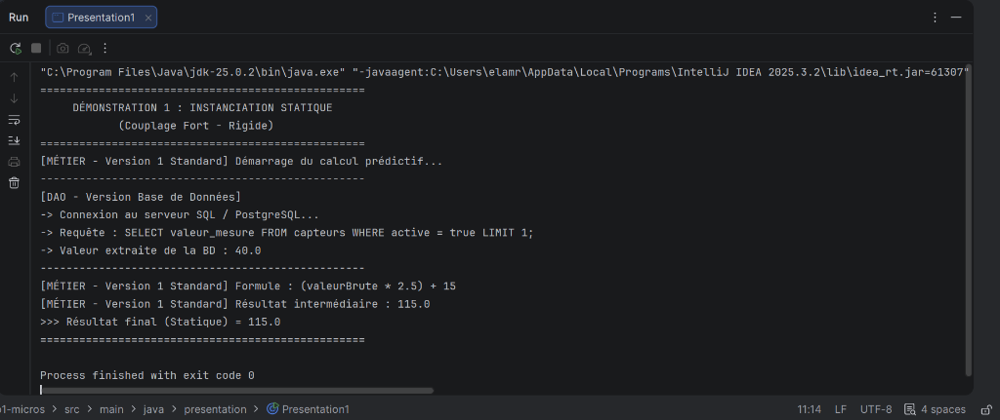
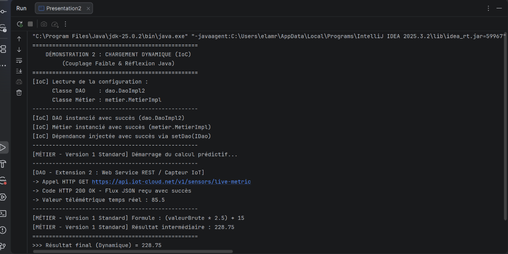

# Microservice de Calcul Télémétrique & Inversion de Contrôle (IoC)


Ce projet simule un **microservice de surveillance et calcul télémétrique (IoT & Énergie)** mettant en application les principes fondamentaux de l'**Inversion de Contrôle (IoC)**, de l'**Injection de Dépendances (DI)** et du principe **Ouvert/Fermé (OCP)** du SOLID en Java.

---

## 🎯 Objectifs Pédagogiques

1. **Comprendre le Couplage Fort vs Couplage Faible** :
   - Observer les limitations du couplage direct via l'opérateur `new` (`Presentation1`).
   - Mettre en œuvre le couplage faible grâce aux interfaces (`IDao`, `IMetier`).
2. **Implémenter un Conteneur IoC par Réflexion** :
   - Charger et instancier dynamiquement des classes au runtime via `Class.forName()`, `getDeclaredConstructor().newInstance()`.
   - Injecter les dépendances via introspection (`Method.invoke()`).
3. **Appliquer le principe OCP (Open/Closed Principle)** :
   - Ajouter de nouvelles extensions (`DaoImpl2`, `MetierImpl2`) sans modifier le code source existant, simplement en modifiant le fichier de configuration `config.txt`.

---

## 🏗️ Architecture du Projet

```text
lab1-micros/
├── screenshots/
│   ├── presentation1-statique.png       # Capture d'écran Démonstration 1
│   └── presentation2-dynamique.png      # Capture d'écran Démonstration 2
├── src/
│   ├── main/
│   │   ├── java/
│   │   │   ├── dao/
│   │   │   │   ├── IDao.java            # Interface DAO (contrat getValue())
│   │   │   │   ├── DaoImpl.java         # Version 1 : Base de données relationnelle (valeur = 40.0)
│   │   │   │   └── DaoImpl2.java        # EXTENSION 2 : Web Service REST / IoT (valeur = 85.5)
│   │   │   ├── metier/
│   │   │   │   ├── IMetier.java         # Interface Métier (contrat calcul())
│   │   │   │   ├── MetierImpl.java      # Version 1 : Algorithme prédictif standard
│   │   │   │   └── MetierImpl2.java     # EXTENSION 2 : Calcul avancé haute précision
│   │   │   └── presentation/
│   │   │       ├── Presentation1.java   # Démo 1 : Instanciation Statique (Couplage fort)
│   │   │       └── Presentation2.java   # Démo 2 : Moteur de chargement dynamique IoC
│   │   └── resources/
│   │       └── config.txt               # Fichier de configuration des classes à injecter
│   └── config.txt
├── config.txt                           # Fichier de configuration à la racine
├── pom.xml                              # Configuration Maven du projet
└── README.md
```

---

## 🧩 Couches Logiques

### 1. Couche Persistance (DAO)
- **`IDao`** : Interface exposant la méthode `double getValue()`.
- **`DaoImpl`** : Version simulée de lecture depuis une base de données relationnelle SQL.
- **`DaoImpl2` *(Extension)*** : Version temps réel simulant la consommation d'une API distante / capteur IoT sans fil.

### 2. Couche Métier
- **`IMetier`** : Interface métier exposant la méthode `double calcul()`.
- **`MetierImpl`** : Implémentation dépendante de `IDao` via une injection par setter (`setDao(IDao dao)`).
- **`MetierImpl2` *(Extension)*** : Variante métier à haute précision avec marge de sécurité.

### 3. Fichier de Configuration (`config.txt`)
Définit dynamiquement les implémentations actives sans recompiler le code :
```text
dao.DaoImpl2
metier.MetierImpl
```

---

## 📸 Résultats & Captures d'Écran

### 1. Démonstration 1 : Instanciation Statique (Couplage Fort)
Dans [Presentation1.java](src/main/java/presentation/Presentation1.java), les composants sont instanciés directement avec l'opérateur `new` (`new DaoImpl()`, `new MetierImpl()`). Le code est rigide et lié aux classes concrètes :



```text
==================================================
     DÉMONSTRATION 1 : INSTANCIATION STATIQUE     
            (Couplage Fort - Rigide)              
==================================================
[MÉTIER - Version 1 Standard] Démarrage du calcul prédictif...
--------------------------------------------------
[DAO - Version Base de Données]
-> Connexion au serveur SQL / PostgreSQL...
-> Requête : SELECT valeur_mesure FROM capteurs WHERE active = true LIMIT 1;
-> Valeur extraite de la BD : 40.0
--------------------------------------------------
[MÉTIER - Version 1 Standard] Formule : (valeurBrute * 2.5) + 15
[MÉTIER - Version 1 Standard] Résultat intermédiaire : 115.0
>>> Résultat final (Statique) = 115.0
==================================================
```

---

### 2. Démonstration 2 : Chargement Dynamique IoC (Couplage Faible)
Dans [Presentation2.java](src/main/java/presentation/Presentation2.java), les classes sont lues depuis `config.txt` puis chargées par réflexion. Le composant `DaoImpl2` (extension IoT) est injecté dynamiquement sans toucher à une seule ligne de code :



```text
==================================================
    DÉMONSTRATION 2 : CHARGEMENT DYNAMIQUE (IoC)   
         (Couplage Faible & Réflexion Java)       
==================================================
[IoC] Lecture de la configuration :
      Classe DAO    : dao.DaoImpl2
      Classe Métier : metier.MetierImpl
--------------------------------------------------
[IoC] DAO instancié avec succès (dao.DaoImpl2)
[IoC] Métier instancié avec succès (metier.MetierImpl)
[IoC] Dépendance injectée avec succès via setDao(IDao)
--------------------------------------------------
[MÉTIER - Version 1 Standard] Démarrage du calcul prédictif...
--------------------------------------------------
[DAO - Extension 2 : Web Service REST / Capteur IoT]
-> Appel HTTP GET https://api.iot-cloud.net/v1/sensors/live-metric
-> Code HTTP 200 OK - Flux JSON reçu avec succès
-> Valeur télémétrique temps réel : 85.5
--------------------------------------------------
[MÉTIER - Version 1 Standard] Formule : (valeurBrute * 2.5) + 15
[MÉTIER - Version 1 Standard] Résultat intermédiaire : 228.75
==================================================
>>> Résultat final (Dynamique) = 228.75
==================================================
```

---

## 🚀 Compilation & Exécution

### Avec Maven
```powershell
# Nettoyer et compiler
mvn clean compile

# Lancer la version statique
mvn exec:java -Dexec.mainClass="presentation.Presentation1"

# Lancer la version dynamique (IoC)
mvn exec:java -Dexec.mainClass="presentation.Presentation2"
```

### Directement en ligne de commande (Java CLI)
```powershell
# Compilation
javac -d bin src/main/java/dao/*.java src/main/java/metier/*.java src/main/java/presentation/*.java

# Exécution
java -cp bin presentation.Presentation1
java -cp bin presentation.Presentation2
```

---

## 👩‍💻 Auteur

- **Houda Elamrani** - [GitHub](https://github.com/houdaelamrani)
